# station-signs

Vector recreations of train station signs that mean something to me, from rail systems around
the world. They're built in **VectorCraft**, with an AI agent drawing live in the app.

## Stations

| Sign | Station | City, Country | Visited |
|---|---|---|---|
| <a href="stations/sutthisan/">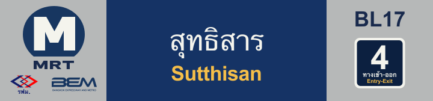</a> | [Sutthisan](stations/sutthisan/) | Bangkok, Thailand | Mar 2024 |
| <a href="stations/roma-termini/">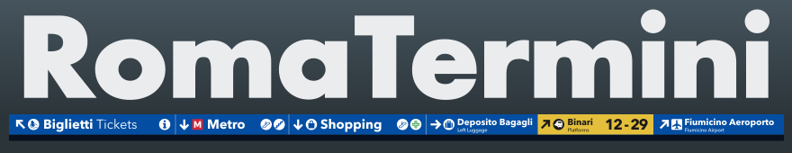</a> | [Roma Termini](stations/roma-termini/) | Rome, Italy | Sep 2024 |
| <a href="stations/prince-edward/">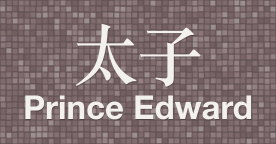</a> | [Prince Edward](stations/prince-edward/) | Hong Kong | Feb 2025 |
| <a href="stations/artis/">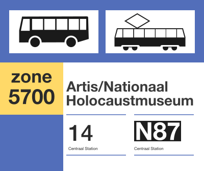</a> | [Artis](stations/artis/) | Amsterdam, Netherlands | Aug 2025 |
| <a href="stations/vilnius/"></a> | [Vilnius](stations/vilnius/) | Vilnius, Lithuania | Aug 2025 |
| <a href="stations/anneessens-fontainas/">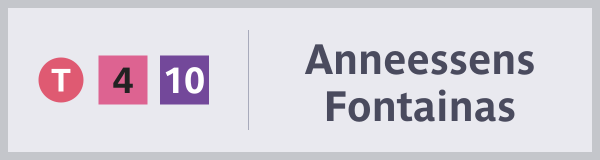</a> | [Anneessens-Fontainas](stations/anneessens-fontainas/) | Brussels, Belgium | Sep 2025 |
| <a href="stations/ueno/">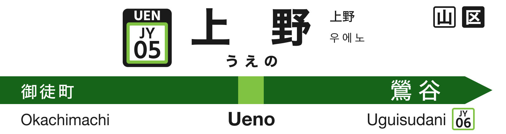</a> | [Ueno](stations/ueno/) | Tokyo, Japan | Mar 2026 |
| <a href="stations/phrom-phong/">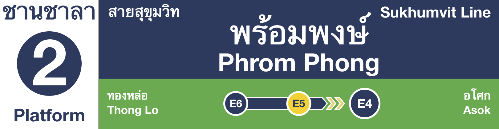</a> | [Phrom Phong](stations/phrom-phong/) | Bangkok, Thailand | Apr 2026 |
| <a href="stations/rochor/">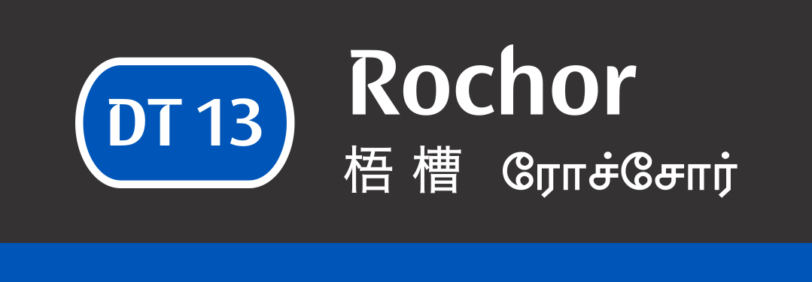</a> | [Rochor](stations/rochor/) | Singapore | Jun 2026 |
| <a href="stations/ujezd/">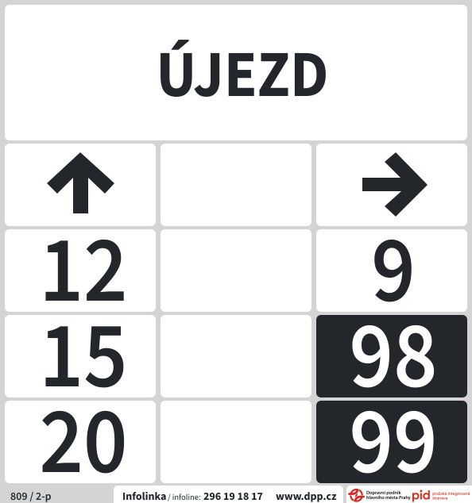</a> | [Újezd](stations/ujezd/) | Prague, Czechia | Aug 2026 |
| <a href="stations/gare-de-lyon/">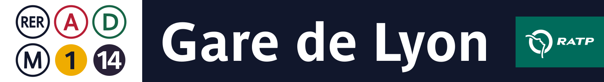</a> | [Gare de Lyon](stations/gare-de-lyon/) | Paris, France | Aug 2026 |
| <a href="stations/garibaldi/">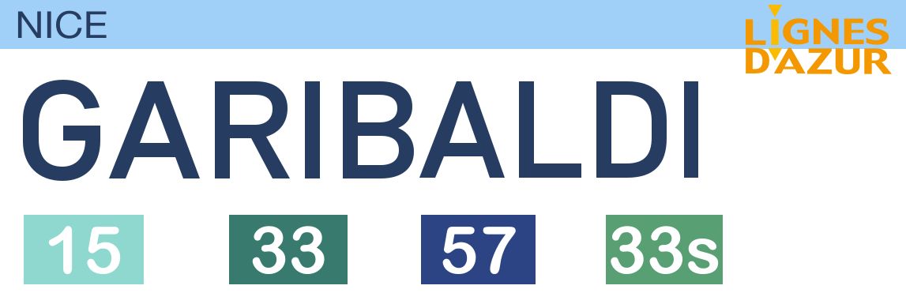</a> | [Garibaldi](stations/garibaldi/) | Nice, France | Aug 2026 |
| <a href="stations/akihabara/">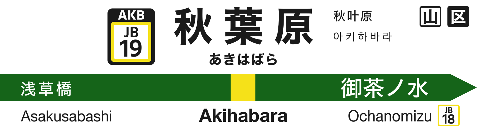</a> | [Akihabara](stations/akihabara/) | Tokyo, Japan | Sep 2026 |
| <a href="stations/formosa-boulevard/"></a> | [Formosa Boulevard](stations/formosa-boulevard/) | Kaohsiung, Taiwan | Oct 2026 |

## Requirements

- VectorCraft 0.24.1 (desktop app) and `vectorcraft-cli`
- [uv](https://docs.astral.sh/uv/) for the occasional Python helper (image measuring and color
  sampling)
- Whatever fonts a sign's design spec calls for. The Bangkok BTS signs use Thonburi and Helvetica
  Neue, which come with macOS. The Bangkok MRT sign uses Thonburi, Arial, and Avenir Next.
  The JR East signs use Hiragino Sans, Helvetica Neue and Apple SD Gothic
   Neo (also built in), plus Hind (`brew install --cask font-hind`). The Kaohsiung Metro sign uses
    Songti TC, Hiragino Sans GB, and Arial. The Prague tram and Paris RATP signs use
    Source Sans 3; the RATP sign also uses Parisine. The Amsterdam GVB sign uses Helvetica
    Neue, and the Brussels STIB sign uses Parisine. The Nice bus sign uses Helvetica Neue
    and Arial Rounded MT Bold. The Hong Kong MTR wall uses Songti TC and Helvetica Neue. The
    Roma Termini sign uses Futura and Avenir Next. The
    Singapore MRT sign uses LTAIdentity (the
    [IdentityFont](https://github.com/jglim/IdentityFont) reconstruction, installed from its
    TTF), Hiragino Sans GB and InaiMathi.

## Working on a sign

1. Start VectorCraft with its control server:

   ```sh
   open -a VectorCraft --args --control 7979
   ```

2. Open this folder in Claude Code (or another agent) and approve the `vectorcraft` MCP server
   from `.mcp.json` when asked.
3. Open a station's `.vectorcraft` file, or ask for a new one, and describe what you want. The
   agent draws in your VectorCraft window, so you can watch and edit alongside it. For
   subjective tweaks it lays out numbered variants on extra artboards for you to choose from.

## Notes

These are personal, fan-made recreations, not official artwork from any rail operator. Where an
operator publishes no typeface or color specification, the fonts are stand-ins and the colors
were matched from photos. The sources are recorded in the `AGENTS.md` files.
