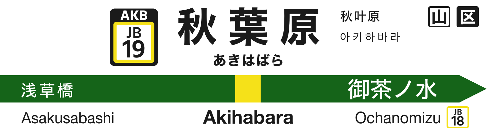

# Akihabara · 秋葉原

Tokyo, Japan. Station **JB19** (AKB) on the JR Chūō–Sōbu Line (local), between Asakusabashi
(JB20) and Ochanomizu (JB18).

Visited in September 2026 with Clark, Paul, Ann, and Mark.

Built in VectorCraft by **Claude Opus 5.5**.

The sign is the station name sign for trains toward Ochanomizu, in
[`akihabara.vectorcraft`](akihabara.vectorcraft).

## Design notes

- It follows the same JR East design as [Ueno](../ueno/): Hiragino Sans for Japanese,
  Helvetica Neue for English and Hind for the badge.
- The line color is Chūō–Sōbu yellow `#f5e119` (a first pass, matched from a photo). The band
  stays JR East's dark green on every line.
- The real sign is wider (about 5:1). This one keeps Ueno's proportions so the set matches.
- The full decision log is in [`AGENTS.md`](AGENTS.md).
