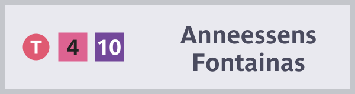

# Anneessens-Fontainas

Brussels, Belgium. A premetro station on the STIB North–South axis under the city center,
between Bourse and Lemonnier. It's named after Anneessens square and Fontainas square above it.

Visited in September 2025 with David.

Built in VectorCraft by **Claude Opus 5.5**.

This is the station name sign, with the tram symbol and trams **4** and **10**.

STIB's signs use Brusseline, a typeface designed by Eric de Berranger in 2006 for STIB's own use.
It isn't sold or publicly available, so this recreation uses Parisine instead, the Paris transit
typeface that Brusseline was named after. The letter shapes are close but not exact.

The editable source is [`anneessens-fontainas.vectorcraft`](anneessens-fontainas.vectorcraft).
