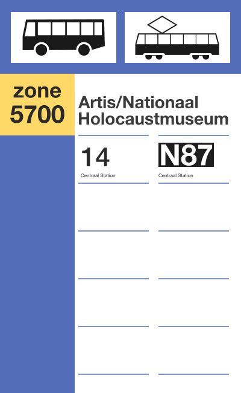
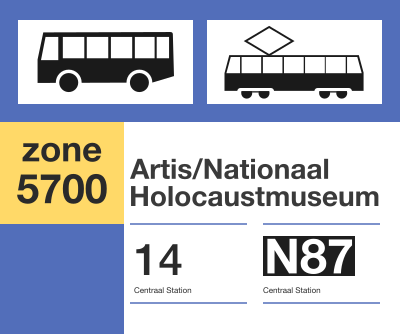

# Artis

Amsterdam, Netherlands. A GVB tram stop on Plantage Middenlaan, next to the Artis zoo, now named
**Artis/Nationaal Holocaustmuseum** after the nearby National Holocaust Museum.

Visited in August 2025 with David.

Built in VectorCraft by **Claude Opus 5.5**.

This is the stop flag on the westbound side, toward Centraal Station. It shows tram **14**,
night bus **N87**, and fare zone **5700**.

There's also a compact version, with the empty line slots removed:

The editable sources are [`artis.vectorcraft`](artis.vectorcraft) and
[`artis-compact.vectorcraft`](artis-compact.vectorcraft).
