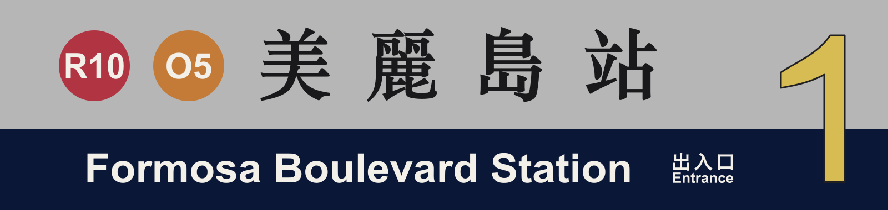

# Formosa Boulevard · 美麗島站

Kaohsiung, Taiwan. Station **R10/O5** on the Kaohsiung Metro. On the Red Line it sits between
Central Park (R9) and Kaohsiung Main Station (R11); on the Orange Line it sits between Cianjin
(O4) and Sinyi Elementary School (O6).

Visited in October 2026 with Ann and Mark.

Built in VectorCraft by **GPT-6.2 Sol**.

This recreation shows **Entrance 1**, with its yellow numeral spanning both bands. The clearer
Entrance 10 photo supplied the lettering measurements and the sampled blue; the upper face
uses a light neutral gray chosen separately. The Entrance 1 photo supplied the numeral. The source is
[`formosa-boulevard.vectorcraft`](formosa-boulevard.vectorcraft);
see [`AGENTS.md`](AGENTS.md) for design notes.
