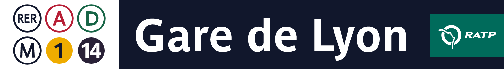

# Gare de Lyon



Paris, France. This RATP entrance sign shows **RER A and D** and **Métro 1 and 14**. On
Métro 1, Gare de Lyon is between Bastille and Reuilly–Diderot. On Métro 14, it is between
Châtelet and Bercy.

Visited in August 2026 with David.

Built in VectorCraft by **GPT-6.2 Sol**.

The recreation keeps the two rows of badges and the teal RATP plaque from the reference,
but uses a rectangular face instead of the curved housing. The editable source is
[`gare-de-lyon.vectorcraft`](gare-de-lyon.vectorcraft).

The station name uses Parisine Bold. If it is not installed, see [`AGENTS.md`](AGENTS.md)
for the manual Source Sans 3 Bold substitute.

## Export

Run from this folder:

```sh
mkdir -p exports
vectorcraft-cli convert gare-de-lyon.vectorcraft exports/gare-de-lyon.pdf
```
