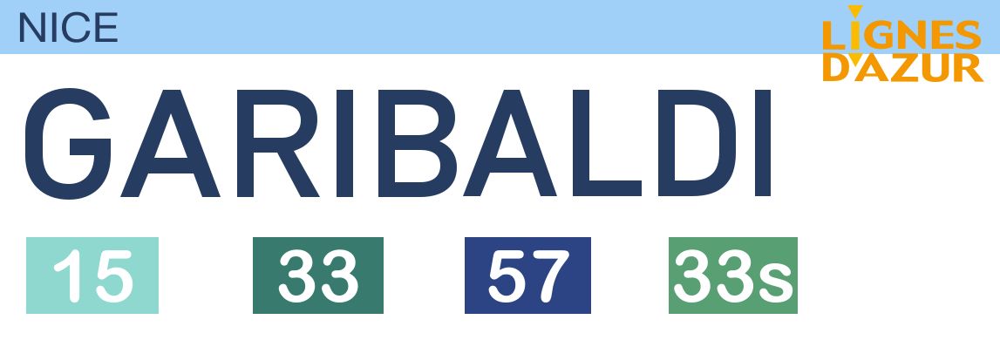

# Garibaldi

Nice, France. This Lignes d’Azur bus shelter sign displays routes **15, 33, 57, and 33s**.
On line 15 toward Lycée Masséna, it sits between Port Lympia / Arson and Lycée Masséna.
The artwork shows the routes printed on the sign, not a live timetable.

Visited in August 2026 with David.

Built in VectorCraft by **GPT-6.2 Sol**. Compact version by **Claude Opus 5.5**.

There's also a compact version, with the logo pulled in next to the name and the empty space
at the bottom removed:

The editable sources are [`garibaldi.vectorcraft`](garibaldi.vectorcraft) and
[`garibaldi-compact.vectorcraft`](garibaldi-compact.vectorcraft).
