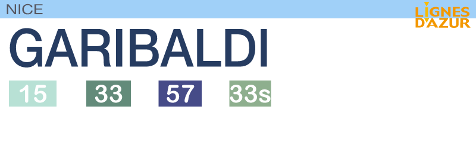

# Garibaldi



Nice, France. This Lignes d’Azur bus shelter sign displays routes **15, 33, 57, and 33s**.
On line 15 toward Lycée Masséna, it sits between Port Lympia / Arson and Lycée Masséna.
The artwork shows the routes printed on the sign, not a live timetable.

Visited in August 2026, after Prague and Paris.

Built in VectorCraft by **GPT-6.2 Sol**.

The editable source is [`garibaldi.vectorcraft`](garibaldi.vectorcraft).

## Export

Run from this folder:

```sh
mkdir -p exports
vectorcraft-cli convert garibaldi.vectorcraft exports/garibaldi.pdf
```
