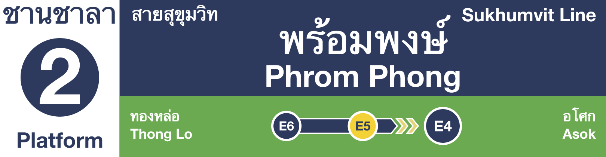

# Phrom Phong · พร้อมพงษ์



Bangkok, Thailand. Station **E5** on the BTS Skytrain Sukhumvit Line, between Thong Lo (E6) and
Asok (E4).

Visited in April 2026 with Rodj and Kurt.

Built in VectorCraft by **Claude Opus 5.5**.

The sign is the Platform 2 sign (heading toward Asok), in
[`phrom-phong.vectorcraft`](phrom-phong.vectorcraft).

## Export

```sh
mkdir -p exports
vectorcraft-cli convert phrom-phong.vectorcraft exports/phrom-phong.pdf
```

Run this from this folder. For a PNG, use `exports/phrom-phong.png --ppi 300`.

## Design notes

- Thai text is Thonburi Regular with a 1 pt outline. Latin text is Helvetica Neue Bold.
- The colors are navy `#2d3a5e`, green `#6baa51`, yellow `#f2d237` and chevrons `#e5d377`,
  matched from photos. BTS publishes no official spec.
- The full decision log is in [`AGENTS.md`](AGENTS.md).
