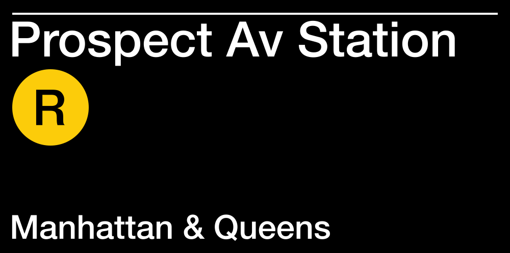

# Prospect Av

Brooklyn, New York City, USA. An **R** stop on the BMT Fourth Avenue Line, between
4 Av–9 St and 25 St.

Visited in May 2019 with Rodj.

Built in VectorCraft by **GPT-6.2 Sol**.

This is the entrance sign for **Manhattan & Queens**. The Street View image supplied the
layout; New York City Transit’s sign conventions and the MTA’s R badge supplied the colors
and style.

The editable source is [`prospect-av.vectorcraft`](prospect-av.vectorcraft); see
[`AGENTS.md`](AGENTS.md) for design notes.
