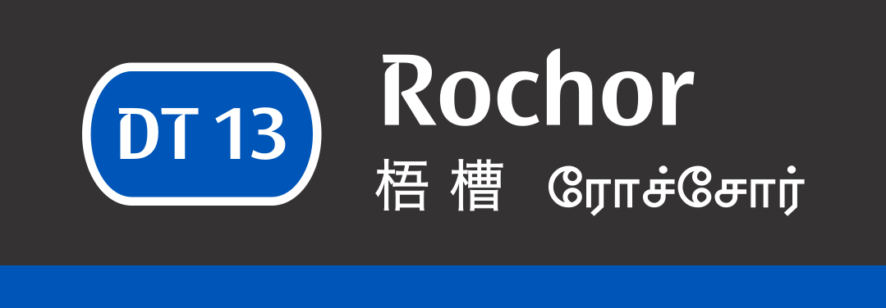

# Rochor · 梧槽 · ரோச்சோர்

Singapore. Station **DT13** on the MRT Downtown Line, between Little India (DT12) and
Bugis (DT14).

Visited in June 2026 with David and Arjan.

Built in VectorCraft by **Claude Opus 5.5**.

This is the platform's station name sign: the DT 13 code badge, the name in English, Chinese
and Tamil, and the Downtown Line's blue bar along the bottom. English and the code use
[IdentityFont](https://github.com/jglim/IdentityFont), an open reconstruction of LTA's
LTAIdentity.

There's also a compact version, with the wide empty margins at the sides trimmed:

The editable sources are [`rochor.vectorcraft`](rochor.vectorcraft) and
[`rochor-compact.vectorcraft`](rochor-compact.vectorcraft); see [`AGENTS.md`](AGENTS.md) for
design notes.
