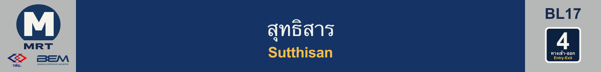
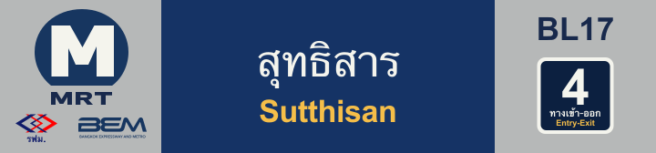

# Sutthisan · สุทธิสาร

Bangkok, Thailand. Station **BL17** on the MRT Blue Line, between Ratchadaphisek (BL16)
and Huai Khwang (BL18).

Visited in March 2024 with Rodj.

Built in VectorCraft by **GPT-6.2 Sol**.

This is the Exit 4 entrance sign, with white Thai and gold English lettering on navy.
The MRT emblem was redrawn from the sign photo, and the MRTA and BEM logos were redrawn
from separate logo references.

There's also a compact version, with less blue space around the station name:

The editable sources are [`sutthisan.vectorcraft`](sutthisan.vectorcraft) and
[`sutthisan-compact.vectorcraft`](sutthisan-compact.vectorcraft). See
[`AGENTS.md`](AGENTS.md) for design notes.
