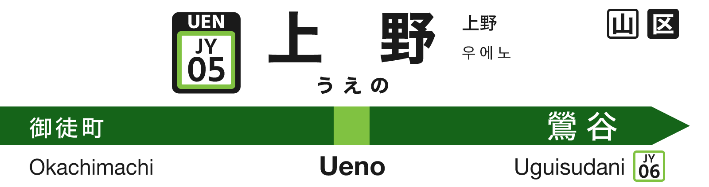

# Ueno · 上野



Tokyo, Japan. Station **JY05** (UEN) on the JR Yamanote Line, between Okachimachi (JY04) and
Uguisudani (JY06).

Visited in March 2026 with Clark and Paul.

Built in VectorCraft by **Claude Opus 5.5**.

The sign is the station name sign for trains toward Uguisudani, in
[`ueno.vectorcraft`](ueno.vectorcraft).

## Export

```sh
mkdir -p exports
vectorcraft-cli convert ueno.vectorcraft exports/ueno.pdf
```

Run this from this folder. For a PNG, use `exports/ueno.png --ppi 300`.

## Design notes

- Japanese is Hiragino Sans W7 (W5 for the neighbor names), English is Helvetica Neue (Bold for Ueno, Regular for the
  neighbors), badge text is Hind, and Korean is Apple SD Gothic Neo. They stand in for JR East's
  Shin Go, Helvetica and Frutiger.
- The colors are a dark green band `#156419` and Yamanote green `#80c241`, matched from a photo.
- The full decision log is in [`AGENTS.md`](AGENTS.md).
