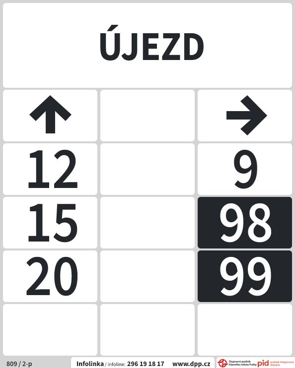

# Újezd

Prague, Czechia. A DPP tram stop in the PID network, near the Petřín funicular. Neighboring
stops include Švandovo divadlo, Tyršův dům, and Národní divadlo, depending on the route.

Visited in August 2026 with David.

Built in VectorCraft by **GPT-6.2 Sol**.

This is the tram direction sign marked **809 / 2-p**. Routes **12, 15, and 20** continue straight;
**9, 98, and 99** turn right. The footer includes the bilingual information line, `www.dpp.cz`,
and the marks of **DPP** (Prague Public Transit Company) and **PID** (Prague Integrated Transport).

The editable source is [`ujezd.vectorcraft`](ujezd.vectorcraft).
