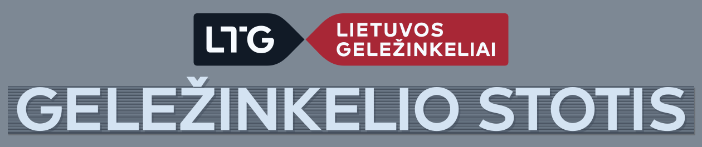

# Vilnius · Vilniaus geležinkelio stotis

Vilnius, Lithuania. The city's main railway station, served by LTG Link.

Visited in August 2025 with David.

Built in VectorCraft by **GPT-6.2 Sol**.

The recreation shows the LTG / Lietuvos geležinkeliai logo and the **GELEŽINKELIO STOTIS**
(“Railway Station”) lettering mounted on horizontal slats, against a stone-gray background.
LTG uses Euclid Circular A on its website, but the large facade letters differ and were
redrawn from the photo rather than typeset.

There's also a compact version, with just the LTG ribbon on a transparent background:

The editable sources are [`vilnius.vectorcraft`](vilnius.vectorcraft) and
[`vilnius-compact.vectorcraft`](vilnius-compact.vectorcraft). See
[`AGENTS.md`](AGENTS.md) for the font comparison and design notes.
